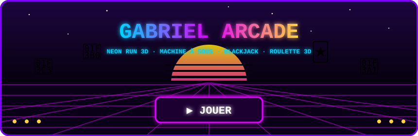
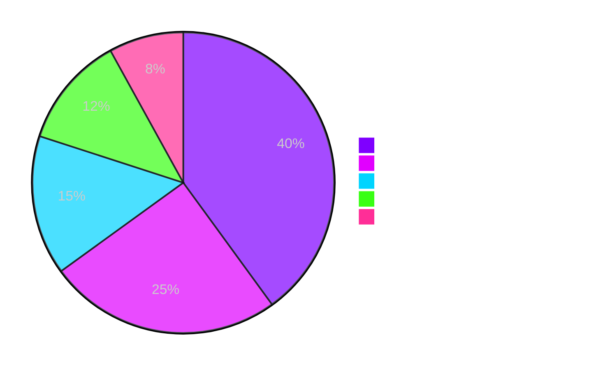

<!-- ════════════ BANNIÈRE ════════════ -->
<p align="center">
  
</p>

<p align="center">
  <a href="https://github.com/Yxhiikoo">
    
  </a>
</p>

<p align="center">
  
  <a href="https://github.com/Yxhiikoo?tab=followers"></a>
  <a href="https://github.com/Yxhiikoo?tab=repositories"></a>
  
</p>

<p align="center">
  
</p>

<h3 align="center">🕹️ Mes mini-jeux jouables — clique pour jouer !</h3>

<p align="center">
  <a href="https://yxhiikoo.github.io/" target="_blank">
    
  </a>
</p>

<p align="center">
  <a href="https://yxhiikoo.github.io/run.html"></a>
  <a href="https://yxhiikoo.github.io/slots.html"></a>
  <a href="https://yxhiikoo.github.io/blackjack.html"></a>
  <a href="https://yxhiikoo.github.io/roulette.html"></a>
</p>


##  Arcade jouable ici même

<!-- ARCADE:START -->
<p align="center"><b>Clique sur un bouton → valide le ticket → mon robot joue ton coup et met à jour ce profil en ~30 s.</b><br /><sub>Tu commences avec 1 000 🪙 fictifs. Aucun argent réel.</sub></p>

<p align="center"></p>
<p align="center">
  <a href="https://github.com/Yxhiikoo/Yxhiikoo/issues/new?title=arcade%7Cslots%7Cspin&body=%F0%9F%91%89%20Clique%20simplement%20sur%20%2A%2ASubmit%20new%20issue%2A%2A%20%28%C2%AB%20Soumettre%20%C2%BB%29%20sans%20rien%20changer.%0A%0A%F0%9F%A4%96%20Le%20robot%20joue%20ton%20coup%20en%20~30%20secondes%2C%20te%20r%C3%A9pond%20ici%20et%20met%20%C3%A0%20jour%20le%20profil%20de%20%40Yxhiikoo%20%21"></a>
</p>

<p align="center"></p>
<p align="center">
  <a href="https://github.com/Yxhiikoo/Yxhiikoo/issues/new?title=arcade%7Croulette%7Crouge&body=%F0%9F%91%89%20Clique%20simplement%20sur%20%2A%2ASubmit%20new%20issue%2A%2A%20%28%C2%AB%20Soumettre%20%C2%BB%29%20sans%20rien%20changer.%0A%0A%F0%9F%A4%96%20Le%20robot%20joue%20ton%20coup%20en%20~30%20secondes%2C%20te%20r%C3%A9pond%20ici%20et%20met%20%C3%A0%20jour%20le%20profil%20de%20%40Yxhiikoo%20%21"></a>
  <a href="https://github.com/Yxhiikoo/Yxhiikoo/issues/new?title=arcade%7Croulette%7Cnoir&body=%F0%9F%91%89%20Clique%20simplement%20sur%20%2A%2ASubmit%20new%20issue%2A%2A%20%28%C2%AB%20Soumettre%20%C2%BB%29%20sans%20rien%20changer.%0A%0A%F0%9F%A4%96%20Le%20robot%20joue%20ton%20coup%20en%20~30%20secondes%2C%20te%20r%C3%A9pond%20ici%20et%20met%20%C3%A0%20jour%20le%20profil%20de%20%40Yxhiikoo%20%21"></a>
  <a href="https://github.com/Yxhiikoo/Yxhiikoo/issues/new?title=arcade%7Croulette%7Cpair&body=%F0%9F%91%89%20Clique%20simplement%20sur%20%2A%2ASubmit%20new%20issue%2A%2A%20%28%C2%AB%20Soumettre%20%C2%BB%29%20sans%20rien%20changer.%0A%0A%F0%9F%A4%96%20Le%20robot%20joue%20ton%20coup%20en%20~30%20secondes%2C%20te%20r%C3%A9pond%20ici%20et%20met%20%C3%A0%20jour%20le%20profil%20de%20%40Yxhiikoo%20%21"></a>
  <a href="https://github.com/Yxhiikoo/Yxhiikoo/issues/new?title=arcade%7Croulette%7Cimpair&body=%F0%9F%91%89%20Clique%20simplement%20sur%20%2A%2ASubmit%20new%20issue%2A%2A%20%28%C2%AB%20Soumettre%20%C2%BB%29%20sans%20rien%20changer.%0A%0A%F0%9F%A4%96%20Le%20robot%20joue%20ton%20coup%20en%20~30%20secondes%2C%20te%20r%C3%A9pond%20ici%20et%20met%20%C3%A0%20jour%20le%20profil%20de%20%40Yxhiikoo%20%21"></a>
  <a href="https://github.com/Yxhiikoo/Yxhiikoo/issues/new?title=arcade%7Croulette%7Cmanque&body=%F0%9F%91%89%20Clique%20simplement%20sur%20%2A%2ASubmit%20new%20issue%2A%2A%20%28%C2%AB%20Soumettre%20%C2%BB%29%20sans%20rien%20changer.%0A%0A%F0%9F%A4%96%20Le%20robot%20joue%20ton%20coup%20en%20~30%20secondes%2C%20te%20r%C3%A9pond%20ici%20et%20met%20%C3%A0%20jour%20le%20profil%20de%20%40Yxhiikoo%20%21"></a>
  <a href="https://github.com/Yxhiikoo/Yxhiikoo/issues/new?title=arcade%7Croulette%7Cpasse&body=%F0%9F%91%89%20Clique%20simplement%20sur%20%2A%2ASubmit%20new%20issue%2A%2A%20%28%C2%AB%20Soumettre%20%C2%BB%29%20sans%20rien%20changer.%0A%0A%F0%9F%A4%96%20Le%20robot%20joue%20ton%20coup%20en%20~30%20secondes%2C%20te%20r%C3%A9pond%20ici%20et%20met%20%C3%A0%20jour%20le%20profil%20de%20%40Yxhiikoo%20%21"></a>
  <a href="https://github.com/Yxhiikoo/Yxhiikoo/issues/new?title=arcade%7Croulette%7C0&body=%F0%9F%91%89%20Clique%20simplement%20sur%20%2A%2ASubmit%20new%20issue%2A%2A%20%28%C2%AB%20Soumettre%20%C2%BB%29%20sans%20rien%20changer.%0A%0A%F0%9F%A4%96%20Le%20robot%20joue%20ton%20coup%20en%20~30%20secondes%2C%20te%20r%C3%A9pond%20ici%20et%20met%20%C3%A0%20jour%20le%20profil%20de%20%40Yxhiikoo%20%21"></a>
  <a href="https://github.com/Yxhiikoo/Yxhiikoo/issues/new?title=arcade%7Croulette%7C17&body=%F0%9F%91%89%20Clique%20simplement%20sur%20%2A%2ASubmit%20new%20issue%2A%2A%20%28%C2%AB%20Soumettre%20%C2%BB%29%20sans%20rien%20changer.%0A%0A%F0%9F%A4%96%20Le%20robot%20joue%20ton%20coup%20en%20~30%20secondes%2C%20te%20r%C3%A9pond%20ici%20et%20met%20%C3%A0%20jour%20le%20profil%20de%20%40Yxhiikoo%20%21"></a>
</p>

<p align="center"></p>
<p align="center">
  <a href="https://github.com/Yxhiikoo/Yxhiikoo/issues/new?title=arcade%7Cbj%7Cnew&body=%F0%9F%91%89%20Clique%20simplement%20sur%20%2A%2ASubmit%20new%20issue%2A%2A%20%28%C2%AB%20Soumettre%20%C2%BB%29%20sans%20rien%20changer.%0A%0A%F0%9F%A4%96%20Le%20robot%20joue%20ton%20coup%20en%20~30%20secondes%2C%20te%20r%C3%A9pond%20ici%20et%20met%20%C3%A0%20jour%20le%20profil%20de%20%40Yxhiikoo%20%21"></a>
</p>
<p align="center"><sub>Lance une main, puis reviens ici pour tirer ou rester.</sub></p>

<details>
<summary><b>🏆 Classement des joueurs & derniers coups</b></summary>

| | Joueur | Jetons | Parties | Victoires |
|:-:|:--|--:|--:|--:|
| 🥇 | [@Yxhiikoo](https://github.com/Yxhiikoo) | 1 050 🪙 | 3 | 2 |

**Derniers coups :**
- 🃏 **@Yxhiikoo** : 18 contre 23 → Le croupier saute ! +100
- 🃏 **@Yxhiikoo** : 17 contre 20 → Le croupier gagne -100
- 🎡 **@Yxhiikoo** : 🔴 Rouge → 31 noir (-100)
- 🎰 **@Yxhiikoo** : 🍒 🍋 🍒 → GAGNÉ x2 · +100
</details>
<!-- ARCADE:END -->


##  À propos de moi

<table>
<tr>
<td width="55%" valign="top">

```js
const gabriel = {
  pseudo:      "Yxhiikoo",
  enCeMoment:  "Je construis des sites web 🌐",
  apprend:     ["JavaScript", "React", "Git avancé"],
  passions:    ["Code", "Design", "Jeux vidéo", "Pixel art"],
  objectif:    "Créer des trucs qui font wow ✨",
  funFact:     "J'ai écrit GABRIEL avec 1 820 commits 😎",
};
```

</td>
<td width="45%" valign="top">

-  **Je bosse sur** des sites web en HTML / CSS / JS
-  **J'apprends** React et les bonnes pratiques Git
-  **Je cherche** des projets cool à rejoindre
-  **Hors du code** : jeux vidéo et pixel art
-  **Fun fact** : regarde mon calendrier 👇

</td>
</tr>
</table>

<details>
<summary><b>🎮 Clique ici pour un easter egg</b></summary>
<br />
<p align="center">
  <code>↑ ↑ ↓ ↓ ← → ← → B A</code><br /><br />
  <i>Bravo, tu as trouvé le Konami code. +30 vies. 🕹️</i>
</p>
</details>


##  Ma stack

<p align="center"><b>Langages & frameworks</b></p>
<p align="center">
  <a href="https://skillicons.dev"></a>
</p>

<p align="center"><b>Outils</b></p>
<p align="center">
  <a href="https://skillicons.dev"></a>
</p>

<p align="center">
  
  
  
  
  
  
  
</p>


##  En ce moment

| | Objectif | Progression |
|:-:|:--|:--|
| ⚛️ | Maîtriser **React** |  |
| 🎨 | Devenir bon en **CSS / animations** |  |
| 🌿 | Git sans paniquer |  |
| 🟨 | **JavaScript** moderne (ES2024+) |  |
| 🐍 | Bases de **Python** |  |
| 🎮 | Coder mon propre jeu |  |

##  Ma journée type



##  Fun facts

<table align="center">
<tr>
<td align="center" width="25%">🌙<br /><b>Night owl</b><br /><sub>Mon meilleur code sort après minuit</sub></td>
<td align="center" width="25%">🐛<br /><b>Chasseur de bugs</b><br /><sub>Je les trouve… souvent après les avoir créés</sub></td>
<td align="center" width="25%">🎨<br /><b>Pixel lover</b><br /><sub>Mon calendrier en est la preuve</sub></td>
<td align="center" width="25%">⌨️<br /><b>Ctrl+Z addict</b><br /><sub>Mon raccourci préféré, de loin</sub></td>
</tr>
</table>

```diff
+ Ce qui me motive : voir un projet prendre vie dans le navigateur
+ Ce que j'aime : les interfaces propres, les animations fluides, le dark mode
- Ce que je déteste : les points-virgules oubliés et les merge conflicts
! Prochain objectif : publier un projet perso dont je suis fier
```


##  Mes projets

<p align="center">
  <a href="https://github.com/Yxhiikoo/cc-portail-entraide">
    
  </a>
  <a href="https://github.com/Yxhiikoo/gabriel">
    
  </a>
</p>


##  Mes stats

<p align="center">
  
  
</p>

<p align="center">
  
</p>

<p align="center">
  
</p>
<p align="center">
  
  
  
</p>


##  Mes contributions en 3D

<p align="center">
  
</p>

<p align="center">
  
</p>

##  Le serpent qui mange mes contributions

<p align="center">
  <picture>
    <source media="(prefers-color-scheme: dark)" srcset="https://raw.githubusercontent.com/Yxhiikoo/Yxhiikoo/output/snake-dark.svg" />
    <source media="(prefers-color-scheme: light)" srcset="https://raw.githubusercontent.com/Yxhiikoo/Yxhiikoo/output/snake.svg" />
    
  </picture>
</p>


##  Salle d'arcade

<p align="center"><b>👻 Pac-Man dévore mes commits</b></p>
<p align="center">
  <picture>
    <source media="(prefers-color-scheme: dark)" srcset="https://raw.githubusercontent.com/Yxhiikoo/Yxhiikoo/output/pacman-contribution-graph-dark.svg" />
    <source media="(prefers-color-scheme: light)" srcset="https://raw.githubusercontent.com/Yxhiikoo/Yxhiikoo/output/pacman-contribution-graph.svg" />
    
  </picture>
</p>

<p align="center"><b>🚀 Galaga attaque mon calendrier</b></p>
<p align="center">
  <picture>
    <source media="(prefers-color-scheme: dark)" srcset="https://raw.githubusercontent.com/Yxhiikoo/Yxhiikoo/output/galaga-contribution-graph-dark.svg" />
    <source media="(prefers-color-scheme: light)" srcset="https://raw.githubusercontent.com/Yxhiikoo/Yxhiikoo/output/galaga-contribution-graph.svg" />
    
  </picture>
</p>

<details>
<summary><b>🧱 Bonus : Casse-briques</b></summary>
<br />
<p align="center">
  <picture>
    <source media="(prefers-color-scheme: dark)" srcset="https://raw.githubusercontent.com/Yxhiikoo/Yxhiikoo/output/breakout-contribution-graph-dark.svg" />
    <source media="(prefers-color-scheme: light)" srcset="https://raw.githubusercontent.com/Yxhiikoo/Yxhiikoo/output/breakout-contribution-graph.svg" />
    
  </picture>
</p>
</details>

<p align="center"><sub>🕹️ Tous les jeux sont générés automatiquement à partir de mes vraies contributions</sub></p>


##  Pause café

<p align="center">
  
</p>

<details>
<summary><b>😂 Une blague de dev ?</b></summary>
<br />
<p align="center">
  
</p>
</details>

---

<p align="center">
  
</p>


